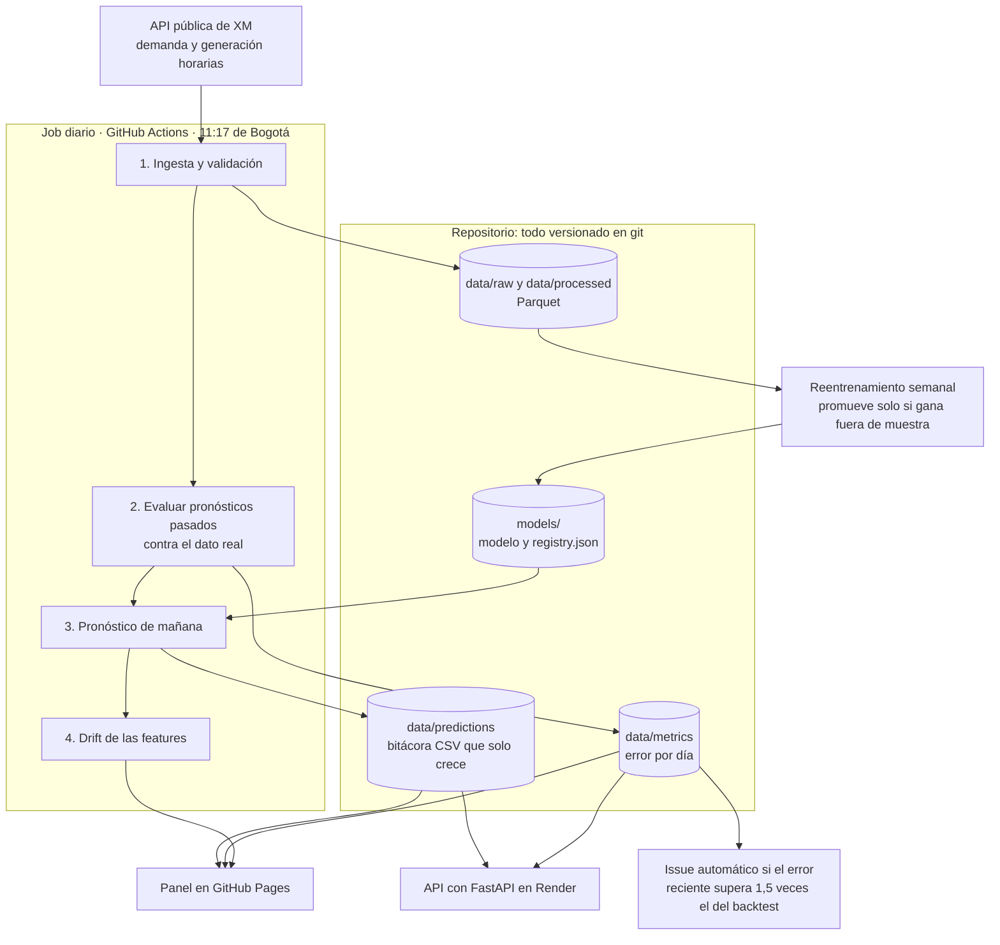

# energuia

[](https://github.com/hoseStr/energuia/actions/workflows/ci.yml)
[](https://github.com/hoseStr/energuia/actions/workflows/daily.yml)

Cada día, sin intervención, este sistema pronostica la demanda horaria de energía eléctrica de Colombia para el día siguiente (24 valores) con los datos públicos de XM, el operador del mercado.
Cada pronóstico queda escrito en el repositorio antes de que empiece su día y después se compara con el dato real, a la vista de cualquiera.

## En vivo

| Qué | Dónde |
|---|---|
| Panel: pronóstico contra real y error acumulado | [en español](https://hosestr.github.io/energuia/?lang=es) · [in English](https://hosestr.github.io/energuia/?lang=en) |
| API: pronóstico vigente y métricas | https://energuia-api.onrender.com/docs |
| Bitácora de pronósticos emitidos | [`data/predictions/`](data/predictions) |
| Corridas diarias | [Actions → Daily forecast](https://github.com/hoseStr/energuia/actions/workflows/daily.yml) |

La API corre en la capa gratuita de Render y se duerme tras 15 minutos sin tráfico: la primera petición puede tardar cerca de un minuto.

## Arquitectura



No hay base de datos ni servidor propio: los datos, la bitácora y el modelo viven en el repositorio, y GitHub Actions hace todo el trabajo programado.

## Resultados

Backtest walk-forward sobre 12 meses (2025-11-01 a 2026-10-31, 8 760 horas), reentrenando cada mes.
Cada pronóstico se emite un día antes y solo usa lo que XM ya había publicado en ese momento: la demanda hasta 5 días antes de la emisión y la generación hasta 3 días antes.

| Modelo | MAE (MWh) | MAPE (%) |
|---|---|---|
| Ingenuo estacional (mismo día de la semana anterior) | 338,6 | 3,40 |
| Promedio de las últimas 4 semanas | 300,5 | 3,03 |
| **LightGBM** | **194,5** | **1,96** |

- La meta era bajar al menos un 15 % el MAPE del mejor baseline. El modelo lo baja un 35 %.
- La mayor ganancia está en los festivos entre semana: los baselines se equivocan un 11 % y el modelo un 2,5 %.
- Los peores días que quedan son caídas bruscas de la demanda que no se ven con datos de hace 4 a 6 días.
- Las features y los hiperparámetros se eligieron en los 12 meses anteriores a esa ventana. La ventana de evaluación se corrió una sola vez, con todo ya fijado.

El detalle por tipo de día, por hora y por mes, los diez peores días y el sesgo están en [`docs/error_analysis.md`](docs/error_analysis.md).

El backtest es una simulación. El error real en producción se acumula en el [panel](https://hosestr.github.io/energuia/) y en `/metrics` desde el primer pronóstico registrado, el del 16 de noviembre de 2026.

## Cómo reproducir el backtest

Solo hace falta [uv](https://docs.astral.sh/uv/), que instala la versión de Python del proyecto. Los datos van en el repositorio, así que no se necesita conexión con XM.

```
git clone https://github.com/hoseStr/energuia.git
cd energuia
uv sync
uv run python -m demand_forecast.cli backtest --model lightgbm
```

El último comando tarda uno o dos minutos e imprime la tabla de arriba y su desglose.
Los comandos son los mismos en Windows y en Linux.

La ventana de evaluación son siempre los últimos 12 meses completos de datos, así que avanza un mes cuando XM termina de publicar el mes anterior. Hasta que los datos del repositorio cubran noviembre de 2026 completo (hacia el 5 de diciembre), el comando reproduce la tabla; después evalúa la ventana siguiente y los números cambian.

Otros comandos:

| Comando | Qué hace |
|---|---|
| `uv run pytest` | Corre los tests (un minuto y medio). Ninguno usa la red. |
| `uv run python -m demand_forecast.cli forecast` | Pronóstico de mañana con el modelo vigente y los datos del repositorio. |
| `uv run python -m demand_forecast.cli serve` | Levanta la API en `http://127.0.0.1:8000/docs`. |
| `uv run python -m demand_forecast.cli ingest` | Descarga de XM los últimos 31 días y reconstruye las tablas. |
| `uv run python -m demand_forecast.cli --help` | Lista todos los comandos. |

Los tests del informe de drift necesitan Evidently, que va en un grupo aparte: `uv sync --group monitoring`. Sin él esos tests se saltan.

## Decisiones de diseño

Las decisiones, con sus motivos y las mediciones que las respaldan, están en [`docs/decisions.md`](docs/decisions.md). Las que más pesan:

- **Sin fuga temporal.** XM publica la demanda con unos 5 días de retraso y sin marcar los días incompletos. Toda lectura del pasado pasa por un corte de disponibilidad, y un test altera los datos aún no publicados y comprueba que el pronóstico no cambia.
- **Evaluación separada de la selección.** Features e hiperparámetros se deciden en una ventana; el resultado se mide en otra que no se usa para ajustar nada.
- **El modelo pronostica una razón, no kWh.** La demanda se duplicó entre 2000 y 2025 y los árboles no extrapolan. El modelo predice la demanda relativa al perfil reciente de los días del mismo tipo, y todas las features de carga son razones.
- **La bitácora de pronósticos solo crece.** Es un CSV en texto plano: el historial de git muestra que cada pronóstico se escribió antes de su día y que ninguna línea cambió después. El código rechaza reescribir un día o rellenar un hueco, y el workflow lo comprueba otra vez antes de commitear.
- **La API no calcula: sirve la bitácora.** Así no pueden existir dos versiones del pronóstico de un mismo día.
- **Si XM se atrasa, el job tolera hasta 7 días más y después falla.** El límite sale de medir cuánto empeora el error con datos más viejos: con una semana de atraso el modelo aún supera al mejor baseline con datos al día.
- **El reentrenamiento se compara fuera de muestra.** Comparar un modelo recién entrenado con el vigente en las últimas semanas tiene fuga, porque el candidato ya vio esos días. Se compara el modelo vigente congelado contra modelos reentrenados cada semana, solo en días posteriores a su entrenamiento.
- **Umbrales de drift calibrados con el propio entrenamiento.** Con el umbral por defecto de Evidently, el 93 % de los meses normales del pasado saldría con drift.

## Limitaciones conocidas

- **Poca historia en producción.** La bitácora empezó en noviembre de 2026. Hasta que acumule semanas, la evidencia principal es el backtest.
- **El backtest usa datos ya revisados.** En producción los días recientes llegan en versión preliminar; las revisiones observadas son de hasta un 0,04 %.
- **El retraso de publicación se supone fijo** (5 días para la demanda, 3 para la generación). Se midió en cinco días de noviembre de 2026; si XM se atrasa en festivos, el error de esos días será mayor que el del backtest.
- **Sin clima.** Las caídas de varios días seguidos que el modelo no ve son el tipo de error que la temperatura podría explicar.
- **Sesgo.** En el backtest el modelo pronostica de más un 0,34 % en promedio. No se corrigió, porque ajustarlo con la ventana de evaluación sería ajustar la evaluación.
- **Un día sin corrida queda vacío.** Si GitHub retrasa el job más allá de la medianoche de Bogotá, ese día se queda sin pronóstico; no se rellena después.
- **El repositorio crece.** Los datos diarios suman del orden de 150 MB al año al historial de git.
- **Partes aún sin ver en producción** (a noviembre de 2026): la alerta automática y la promoción de un modelo reentrenado. Están probadas con tests, pero todavía no han tenido motivo para dispararse.

## Qué aprendí y qué haría distinto

- **Lo primero es medir cómo llegan los datos.** El plan suponía un retraso de publicación; resultó que los días recientes llegan a medias y sin ninguna marca. Sin los snapshots diarios de la API, el backtest habría usado datos que en producción no existen.
- **Un valor por defecto no es una decisión.** El umbral de drift de la librería marcaba casi todo. Y mi propia calibración dio una falsa alarma el primer día en producción, porque las ventanas de menos de una semana solo conocían un día de la semana. No lo detectaron los tests: apareció al revisar la primera corrida real.
- **La fuga se cuela en los sitios menos obvios.** No estaba en las features, que tenían tests, sino en la regla para promover un modelo reentrenado tal como la había escrito en el plan.
- **Los festivos se resolvieron con el objetivo, no con más features.** Pronosticar contra el perfil de los domingos y festivos recientes hizo más que cualquier indicador de festivo, que en el modelo final casi no pesa.

Lo que haría distinto:

- Empezar la bitácora pública antes, con los baselines, para llegar al final con semanas de evidencia real y no con días.
- Medir el retraso de publicación durante un mes entero, con festivos, antes de fijarlo.
- Probar más de 10 años de entrenamiento: el mejor valor quedó en el borde de la búsqueda.
- Agregar temperatura y pronósticos con intervalos, que quedaron fuera del alcance.

## Cómo está hecho

- **Stack:** Python 3.11, uv, pandas, Pandera, LightGBM, FastAPI, Typer, Evidently, pytest, ruff, Docker, GitHub Actions, GitHub Pages y Render.
- **Código:** `src/demand_forecast/` con `data/` (cliente de XM, ingesta, esquema), `features/`, `models/` (baselines, backtest, entrenamiento, registro, promoción), `serving/` (pronóstico, bitácora, API) y `monitoring/` (evaluación, drift, panel).
- **Documentos:** [`docs/data_notes.md`](docs/data_notes.md) (cómo se comporta la API de XM), [`docs/decisions.md`](docs/decisions.md) y [`docs/error_analysis.md`](docs/error_analysis.md).
- **Proceso:** lo desarrollé con Claude Code, fase por fase, siguiendo [`PLAN.md`](PLAN.md) y las reglas de [`CLAUDE.md`](CLAUDE.md).

Para proponer cambios, ver [`CONTRIBUTING.md`](CONTRIBUTING.md).

Autor: [HoseStr](https://github.com/hoseStr).
